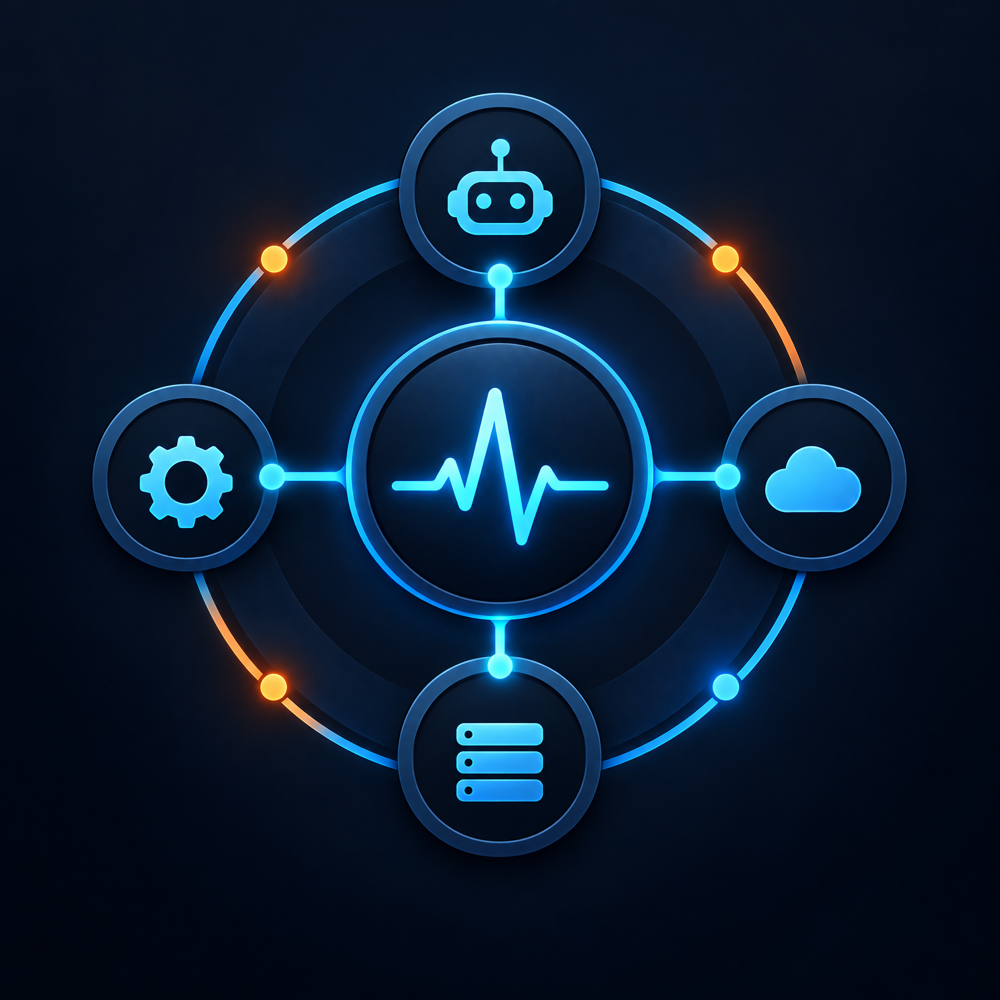
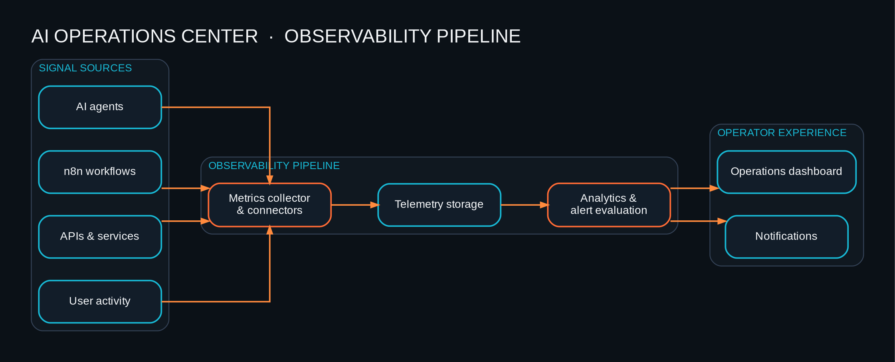

<p align="center">
  
</p>

# AI Operations Center

**A centralized platform for monitoring and managing AI systems, workflows, APIs, and automation infrastructure.**

The product is designed to provide near-real-time operational visibility into AI agents, workflow executions, token usage and estimated costs, API health, error rates, uptime, rate limits, and system performance.

<p>
  
  
  
</p>

**Product concept · Small-business AI infrastructure · Observability-first systems design**  
**Kevin Doherty** · AI Systems Engineer · Automation Architect · Full-Stack Product Builder

> **Project status:** This repository is a portfolio concept and architecture specification—not a functioning monitoring product. The architecture and proposed stack describe a direction for the system; no live integrations, production metrics, or operational performance are claimed.

## The problem

Small teams often assemble AI agents, n8n workflows, SaaS APIs, and customer-facing automations from separate tools. Each tool has its own status screen, logs, usage view, and alerting behavior. When something fails, an operator may have to trace a customer impact across several dashboards and manually reconstruct what happened.

The opportunity is a shared control plane that makes the health and activity of an AI-enabled operation understandable at a glance.

## The solution

**AI Operations Center** brings operational signals into one dashboard concept. It connects agent activity, n8n execution outcomes, API health, resource use, and user activity to an analytics and alerting layer, then presents concise, actionable views for operators.

The product is aimed at small businesses and lean teams that need practical visibility: enough context to notice incidents, diagnose common failures, understand consumption, and decide what needs attention—without turning operations into a full-time specialist discipline.

## Key capabilities

| Capability | What an operator should be able to answer |
| --- | --- |
| **Agent monitoring** | Which agents are active, what their recent run status is, and where failures or delays are occurring. |
| **Workflow analytics** | How n8n workflows are executing, how often they succeed or fail, and which workflows need review. |
| **API health tracking** | Whether connected services are responding, how errors and latency are trending, and when rate limits are being reached. |
| **Token and cost reporting** | How AI consumption is changing over time, with costs clearly identified as estimates unless authoritative billing data is available. |
| **Error detection** | Which failures are recurring, which components are affected, and what operational action is appropriate. |
| **Uptime and health** | Whether monitored services and critical workflow paths are available and meeting their configured health expectations. |
| **Usage analytics** | How the platform is being used, presented with privacy-conscious aggregation and access controls. |
| **Operations dashboards** | A prioritized overview of health, activity, usage, and items that need attention. |
| **Alerting framework** | A foundation for configurable notifications when important thresholds or state changes occur. |

## Architecture

The system is modeled as an observability pipeline: operational sources emit or expose signals; connectors collect and normalize them; analytics identifies useful patterns; and the dashboard turns them into operator decisions.

<p align="center">
  
</p>

```text
AI agents ───────┐
n8n workflows ───┼──> Metrics collector ──> Telemetry storage ──> Analytics & alerts ──> Operations dashboard
APIs/services ──┘                                                                    └──> Notifications
```

The architecture is conceptual. It intentionally avoids vendor-specific endpoints, event schemas, customer data, and production topology. See [`diagrams/architecture.dot`](diagrams/architecture.mmd) and [`docs/architecture.md`](docs/architecture.md) for the source and design notes.

## Proposed technology stack

This is a **proposed stack for an implementation**, not a statement that the software has already been built or deployed.

| Area | Proposed technology | Intended role |
| --- | --- | --- |
| Dashboard | **TypeScript** with a modern web UI | Responsive operational views, filtering, drill-down, and workflow-health summaries. |
| Service layer | **Python** | Integration coordination, metric processing, analytics tasks, and API services. |
| Integration contracts | **REST APIs and webhooks** | Connectors for agents, n8n workflows, and external services. |
| Workflow signals | **n8n** | Workflow execution and health signals exposed through appropriate supported integrations. |
| Observability model | **Metrics, events, and error summaries** | A normalized view across sources, without requiring raw prompt or customer data. |
| Storage | **Pluggable telemetry storage** | Selected later based on volume, retention, query needs, and operating cost. |
| Alerting | **Configurable rules and notification adapters** | Surface meaningful failures and threshold changes without excessive alert noise. |

<p>
  
  
  
  
  
</p>

## System design priorities

- **One operational picture:** bring agent, workflow, and API health into a coherent view while preserving the source of each signal.
- **Normalized, source-aware telemetry:** make cross-system comparison possible without erasing provider context.
- **Useful freshness:** display when each signal was last received so delayed data is not mistaken for healthy data.
- **Actionable alerts:** prioritize a small number of meaningful conditions over noisy notifications.
- **Graceful degradation:** keep the dashboard useful when one connector or provider is unavailable, and make stale or missing telemetry visible.
- **Cost transparency:** separate measured provider charges from estimates based on usage and pricing assumptions.
- **Privacy by design:** collect only the operational metadata needed; avoid retaining prompts, secrets, or unnecessary customer content.
- **Small-business operability:** favor clear defaults, simple onboarding, and understandable actions over complex enterprise configuration.

## Challenges this project addresses

### Fragmented system visibility

A business may depend on multiple agents, automation workflows, and APIs. The proposed operations center groups health and execution signals by source and system so operators can trace issues across a workflow without pretending that all providers expose identical telemetry.

### Noisy and inconsistent signals

Providers report activity and failures in different formats and at different times. A metrics-collection layer needs to normalize comparable signals, preserve provenance, and indicate whether the data is delayed or incomplete.

### Understanding usage and cost

Token consumption and cost can be useful operating indicators, but pricing and billing data are not uniform. The product should label estimated costs clearly, disclose assumptions, and distinguish estimates from confirmed charges.

### Alert fatigue

Monitoring every event is not the same as helping an operator. Alerting should be configurable, contextual, and focused on conditions that merit action, with sensible controls against repeated notifications.

### Secure, privacy-conscious operations

Observability must not become a back door for sensitive prompts, customer data, or credentials. The design favors least-privilege integrations, data minimization, redaction, explicit retention choices, and access-aware reporting.

## Why this is a stronger AI portfolio project

Many AI demos emphasize prompts and generated answers. This concept emphasizes the **operational system around AI**: runtime health, workflow reliability, integration boundaries, usage and cost visibility, failure diagnosis, and operator experience.

It complements work in agents, MCP integrations, and n8n automation by demonstrating an end-to-end systems perspective: building AI-enabled functionality is only part of the job; teams also need ways to observe it, understand its behavior, and operate it responsibly.

## What this demonstrates

- **Python and TypeScript:** a proposed split between service-side operations and an interactive web dashboard.
- **API integration:** a connector-oriented approach across heterogeneous AI, workflow, and service providers.
- **Dashboard product thinking:** organizing technical signals around the decisions small-business operators need to make.
- **System design:** a collection, storage, analytics, alerting, and presentation pipeline with explicit boundaries.
- **Observability:** metrics, events, errors, freshness, uptime, and usage as first-class operational concerns.
- **AI infrastructure:** a focus on the lifecycle and reliability of systems that use AI—not just model output.
- **SaaS thinking:** a product direction that values onboarding, tenant-aware design, operational simplicity, privacy, and sustainable usage visibility.

## Roadmap

### Phase 1 — Product definition

- Define the initial operator personas, core screens, and terminology.
- Prioritize a small set of high-value health and execution signals.
- Define connector capabilities and data freshness expectations.

### Phase 2 — Read-only observability MVP

- Add an initial agent and workflow integration path.
- Display recent activity, status, errors, and API health.
- Establish basic dashboards and transparent usage estimates.

### Phase 3 — Alerting and diagnostics

- Add configurable alerts and notification channels.
- Provide safe context for troubleshooting, with careful redaction and access control.
- Improve recovery guidance and operational summaries.

### Phase 4 — SaaS readiness

- Validate tenant isolation, roles, retention controls, and secure onboarding.
- Evaluate integration reliability, system costs, and small-business support burden.
- Add integrations based on demonstrated user need rather than connector count alone.

## Repository structure

```text
ai-operations-center/
├── README.md
├── assets/
│   └── ai-operations-center-icon.png
├── diagrams/
│   ├── ai-operations-center-architecture.png
│   └── architecture.mmd
├── docs/
│   ├── architecture.md
│   ├── product-brief.md
│   └── security-and-privacy.md
└── screenshots/
    └── README.md
```

## Status and contribution boundary

This is a **portfolio product concept** documenting an intended product direction and high-level design. There is no runnable dashboard, production integration, credential setup, or deployed service in this repository. Future implementation work should begin with a clearly scoped MVP and synthetic test data—not with access to real customer systems.

---

**Kevin Doherty** · AI Systems Engineer · Automation Architect · Full-Stack Product Builder  
**EDGE | AGENCY**
